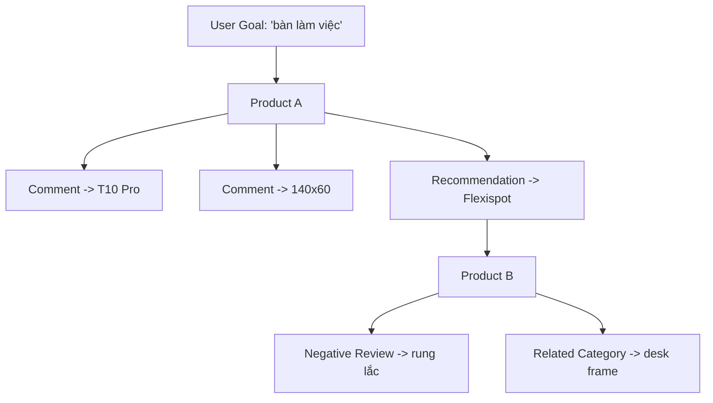

# Autonomous Visual Information Explorer — Project Context / Master Specification

## 0. Mục đích của tài liệu

Tài liệu này là **"nguồn ngữ cảnh chuẩn"** cho dự án một tool/AI chạy local trên Windows, có khả năng dùng màn hình + chuột + bàn phím để tự động thu thập thông tin trên nhiều nền tảng web/app, đặc biệt là social media và marketplace.

### Mục tiêu của tài liệu:
- Có thể đưa nguyên văn cho một AI coding agent/model khác để nó hiểu dự án mà không cần đọc lại toàn bộ lịch sử hội thoại.
- Tránh việc model sau một thời gian "quên" ý tưởng, tự diễn giải sai bài toán hoặc biến dự án thành một web scraper / shopping advisor thông thường.
- Phân biệt rõ các quyết định đã chốt với các phần chưa thiết kế chi tiết.
- Đây là specification về **BÀI TOÁN** và **INTENT**; chưa phải kiến trúc implementation cuối cùng.

---

## 1. Ý tưởng cốt lõi

- Dự án **không** nhằm xây một AI tự tư vấn mua hàng.
- Dự án là một **LOCAL TOOL / AGENT** dùng để **THAY THẾ CÔNG VIỆC TÌM KIẾM THỦ CÔNG CỦA USER**.

### User giao cho tool một mục tiêu rộng, ví dụ:
- *"Tìm hiểu bàn làm việc"*
- *"Tìm ghế ergonomic khoảng 2 triệu"*
- *"Tìm hiểu keyboard Hall Effect"*
- *"Tìm các sản phẩm / thông tin đáng chú ý về X"*

### Sau đó tool tự dùng các nền tảng mà user đang có quyền truy cập để:
- Quan sát màn hình.
- Tìm kiếm.
- Đọc kết quả.
- Chọn thứ đáng chú ý.
- Mở sản phẩm / bài post / nội dung.
- Đọc review, comment, thảo luận.
- Phát hiện product / model / keyword / category / recommendation / pain point mới.
- Biến những thứ phát hiện được thành các "seed" mới.
- Tiếp tục khám phá từ seed mới.
- Tránh lặp lại những gì đã xem.
- Giữ lại bằng chứng, nguồn gốc và lịch sử hành động.
- Chạy tự động trong thời gian dài (ví dụ cả đêm), cho tới khi hết thời gian hoặc không còn yield đáng kể hoặc cần user can thiệp.

> [!IMPORTANT]
> Sau khi tool thu thập xong, **USER tự mang dữ liệu đó sang các AI khác như GPT/Claude để phân tích, so sánh, kiểm chứng và recommend.**  
> $\rightarrow$ Tool này ưu tiên **INFORMATION DISCOVERY / COLLECTION**, không phải **FINAL ANALYSIS**.

---

## 2. Cách nhìn đúng về bài toán

### ❌ Không nên hiểu dự án là:
`Search engine -> scraper -> product database`

### ✔️ Mà phải hiểu là:
```text
USER GOAL
  -> VISUAL COMPUTER-USE AGENT
  -> OBSERVE SCREEN
  -> THINK
  -> ACT
  -> OBSERVE AGAIN
  -> DISCOVER NEW INFORMATION
  -> EXPAND SEARCH
  -> REMEMBER WHERE IT CAME FROM
  -> AVOID DUPLICATION / LOOP
  -> COLLECT EVIDENCE
  -> CONTINUE
```

Đây là một bài toán **"autonomous visual information exploration"** / **"computer-use research agent"**.

### Mấu chốt không nằm ở việc click chuột. Mấu chốt nằm ở:
- State / memory
- Loop prevention
- Provenance
- Frontier management
- Discovery graph
- Evidence storage
- Recovery
- Deciding what to inspect next
- Knowing when the search has diminishing returns

---

## 3. Phạm vi ban đầu

### 3.1. Nền tảng
- Không cố định một nền tảng.
- Ví dụ user nhập *"bàn làm việc"* thì tool có thể dùng nhiều nguồn:
  - Shopee
  - Lazada
  - TikTok
  - Facebook
  - YouTube
  - Google / web browser
  - Các app/web khác mà user đang có thể truy cập
- **Mục tiêu**: Tăng lượng thông tin thu được bằng cách đi xuyên nhiều nguồn khác nhau. Tool không bị giới hạn vào *"1 query -> 1 website"*.

### 3.2. Thiết bị
- **Phạm vi**: Windows, Android.
- Trên Windows có thể dùng `scrcpy` để mirror/control Android từ máy tính.
- **Ý tưởng quan trọng**:
  - Windows là môi trường chính để chạy orchestrator.
  - Android có thể được điều khiển thông qua `scrcpy` / `ADB` hoặc cơ chế phù hợp.
  - Browser/web và Android app nên được coi là các "body" mà cùng một Agent có thể điều khiển.

---

## 4. Computer-use model

Mô hình điều khiển cốt lõi được xác định là:
```text
SCREENSHOT
  -> AI nhìn toàn màn hình
  -> AI suy nghĩ
  -> Chọn hành động (mouse move / click / type / scroll / back ...)
  -> Màn hình thay đổi
  -> SCREENSHOT MỚI
  -> AI nhìn tiếp
```
Đây là mô hình tương tác trung tâm.

### 4.1. Không muốn phụ thuộc hoàn toàn vào DOM
- Tool hướng tới việc có thể hoạt động như một người thực sự đang điều khiển máy:
  - Nhìn màn hình
  - Rê chuột
  - Click
  - Scroll
  - Gõ
  - Quay lại
  - Chuyển app
- DOM / accessibility / structured UI có thể hữu ích như một implementation aid hoặc fallback/optimization, nhưng không được biến dự án thành một scraper phụ thuộc DOM.

### 4.2. Vision là thành phần cốt lõi
Tool phải có khả năng hiểu giao diện ở mức cao hơn OCR đơn thuần.  
Không chỉ "đọc text" mà phải có khả năng suy luận:
- Đâu là search box
- Đâu là product card
- Đâu là nút mở review
- Đâu là comment
- Đâu là phần recommendation
- Đâu là popup
- Đâu là login
- Đâu là captcha / human verification
- Mình đang ở page/state nào

---

## 5. Agent không phải shopping advisor

Tool **KHÔNG** có trách nhiệm:
- Quyết định sản phẩm tốt nhất
- Xếp hạng cuối cùng
- Tư vấn mua gì
- Làm phân tích P/P sâu
- Kiểm chứng hoàn toàn đúng/sai về sản phẩm
- Viết final recommendation

Tool chủ yếu phải:
- Collect
- Discover
- Preserve evidence
- Preserve context
- Preserve provenance

User sẽ dùng GPT/Claude/AI khác cho analysis. Có thể có một số xử lý sơ cấp trong tool, nhưng không được để nó biến thành "final decision maker".

---

## 6. User quyền gì / Agent quyền gì

> [!NOTE]
> **Nguyên tắc quan trọng**: Agent **KHÔNG** được coi tài khoản của user là tài khoản của chính nó. Nó chỉ được "mượn" quyền truy cập của user để thu thập thông tin theo lệnh của user.

### 6.1. Read-oriented interaction (Được phép)
- Mở ứng dụng / website
- Sử dụng session đã tồn tại
- Search
- Mở sản phẩm / bài viết
- Scroll
- Đọc
- Lấy screenshot
- Thu thập dữ liệu mà user có thể nhìn thấy
- Chuyển giữa các nguồn
- Tiếp tục exploration

### 6.2. Không được tự ý sử dụng tài khoản như một social actor (Cấm)
Các hành động kiểu:
- Like, comment, follow, post, message
- Mua hàng
- Thay đổi profile / setting
- Xóa nội dung
- Bất kỳ hành động giao dịch / xã hội nào

$\rightarrow$ **Boundary mong muốn: AGENT-DRIVEN READ-ORIENTED COLLECTION.**

---

## 7. Autonomous execution

User có thể đặt `TimeEnd` (Ví dụ: chạy 1 giờ, 4 giờ, hoặc chạy cả đêm). Trong thời gian đó, tool phải tự chạy.

### Điều kiện dừng mong muốn:
1. `TimeEnd` tới.
2. Exploration frontier thực sự cạn.
3. Search yield giảm xuống rất thấp trong thời gian đủ dài.
4. Có CAPTCHA / human verification / tình trạng bắt buộc user xử lý.
5. Có lỗi nghiêm trọng cần user can thiệp.
6. Manual stop từ user.

> [!TIP]
> Mục tiêu không phải cứ chạy càng lâu càng tốt mà là:  
> *"Tìm càng nhiều product + evidence + comment đáng chú ý càng tốt cho đến khi discovery bắt đầu bão hòa."*

---

## 8. User goal có thể rất rộng

### Ví dụ:
- **Input**: `"bàn làm việc"`
- **Không nhất thiết là**: chỉ tìm product, chỉ trong một mức giá, chỉ trên Shopee.
- **Agent có thể phát hiện**:
  - Bàn chữ L, bàn nâng hạ, bàn 120x60, bàn 140x60
  - Mặt bàn cao su, frame riêng
  - Hãng / model được nhắc tới
  - Category liên quan, keyword mới
  - Các sản phẩm đang được cộng đồng recommend

### Mở rộng biên độ tìm kiếm:
Nếu user cho một tham số như giá `"~2M"`, nó là seed / anchor chứ không nhất thiết là hard filter.  
*Ví dụ*:
`2M` $\rightarrow$ các product cùng category xung quanh giá đó $\rightarrow$ các sản phẩm nổi bật hơi cao hơn $\rightarrow$ các nấc giá cao hơn dần nếu yield vẫn có giá trị.

**Agent phải ghi nhớ**:
- Seed ban đầu là gì.
- Tại sao một item mới được phát hiện.
- Khoảng cách của nó so với seed.
- Nó được mở rộng vì lý do gì.

*Ví dụ*:
- `seed` = "bàn khoảng 2M"
- `candidate` = 2.8M
- `reason` = "same category + strong community evidence"
- `parent` = product/comment nào dẫn tới candidate này

---

## 9. Seed / Expansion model

> [!NOTE]
> **Hình ảnh tư duy quan trọng của dự án**:  
> *"Gieo một hạt, sau đó dây leo lan ra, nhưng không được quên dây leo lan ra từ đâu."*

### 9.1. Seed
Seed có thể đến từ:
- User / search query
- Product / keyword / model name / category
- Comment / review / post / recommendation
- Related product / related technology / price tier / feature

*Ví dụ*:
- **Seed #0001**: `"bàn làm việc"`
- Từ Product A:
  - Comment nhắc `"Flexispot E7"`
  - Comment nhắc `"140x60"`
  - Post nhắc `"gỗ cao su"`
  - $\rightarrow$ Tạo **Seed #0047**, **#0062**, **#0063**.

### 9.2. Seed provenance
Mỗi seed mới phải biết nó đến từ đâu.  
*Ví dụ*:
- `seed`: "T10 Pro"
- `source`: comment
- `parent`: Product A
- `parent comment`: comment_184
- `source URL`: `https://...`
- `screenshot`: `screenshots/seed_0047.png`

$\rightarrow$ Không có seed "trôi nổi" mất nguồn gốc.

---

## 10. Search graph / exploration graph

Dự án nên được hiểu như **GRAPH EXPLORATION** chứ không phải list search.



### Mục đích:
- Không quên đường đi.
- Không lặp vòng.
- Biết tại sao candidate xuất hiện.
- Có thể truy ngược từ một evidence về seed gốc.

---

## 11. Memory — Yêu cầu trọng yếu nhất

> [!CAUTION]
> Đây là phần từng gây thất bại ở tool cũ.  
> **Không được coi**: `"conversation history = memory"`  
> **Không được phụ thuộc vào context window khổng lồ.**

Agent phải có **external persistent state**. Model có thể mất context / restart / crash nhưng state vẫn còn.

### Cần ít nhất các loại memory/state sau:
1. **World State**: Agent đang ở đâu?
   - `platform`: Shopee
   - `app`: Chrome
   - `page_type`: ProductDetail
   - `current_product`: T10 Pro
   - `scroll_position`, `active_tab`, `current_UI_state`
2. **Visited State**: Đã xem gì rồi?
   - URL, product ID, post ID nếu có
   - Content fingerprint, screen fingerprint
   - Timestamp, source/platform
3. **Exploration Graph**: Đi từ đâu tới đâu?
4. **Evidence Ledger**: Đã phát hiện evidence gì?
5. **Exploration Frontier**: Còn những thứ chưa khám phá nào?
   - Frontier là danh sách các item có thể khám phá tiếp theo, có priority.  
   - *Ví dụ*: `T10 Pro — 0.93`, `Flexispot E7 — 0.89`, `140x60 — 0.71`...  
   - Agent lấy item chưa khám phá có expected value cao hơn để làm tiếp.

---

## 12. Loop prevention

Agent phải tránh:
- Mở lại cùng product vô hạn
- Search cùng keyword vô hạn
- Quay lại cùng branch vô hạn
- Scroll qua lại liên tục
- Đọc lại cùng comment
- Phát hiện một entity rồi cứ quay lại entity đó

### Cơ chế nhận diện loop:
Không thể chỉ dùng `visited=true`. Cần cân nhắc:
- URL & Entity identity
- Content fingerprint & Source fingerprint
- Scroll region
- Seed provenance & Last action
- Branch state
- Exploration budget / revisit budget

Có thể cho phép revisit có điều kiện khi có seed mới liên quan, có evidence mới cần kiểm tra, hoặc một nhánh có giá trị cao nhưng trước đó bị thiếu thông tin. Revisit phải có lý do được lưu trữ.

---

## 13. “Visited” không có nghĩa là “never revisit”

*Ví dụ*:
- **Lần 1**: Product A $\rightarrow$ comment phát hiện seed X.
- **Lần 2**: Agent có seed Y liên quan $\rightarrow$ quay lại Product A để tìm Y.

Đây là revisit hợp lệ. Vì vậy cần:
- `visited`: boolean
- `revisit_reason`: string
- `revisit_count`: number
- `what_new_information_is_being_sought`: string

---

## 14. Candidate / Product identity

Nếu cùng một sản phẩm xuất hiện ở nhiều nguồn (Shopee, TikTok, Facebook, Lazada):
- Không nên coi thành 4 sản phẩm hoàn toàn khác nhau.
- Nên có một identity layer:
  - Product Entity
  - Canonical identity
  - Multiple listings / sources
  - Multiple URLs
  - Source-specific information
- *Giai đoạn đầu*: Nếu chưa đủ khả năng deduplicate chắc chắn $\rightarrow$ giữ raw entities riêng, ghi `suspected_same_product = true/unknown` để AI khác xử lý sau.

---

## 15. Category discovery

- User đôi khi không biết chính xác product/category (ví dụ nhập `"bàn làm việc"`).
- Tool không được assume chỉ có một category. Nó phải có thể phát hiện:
  - Bàn thường, bàn gaming, bàn nâng hạ
  - Desk frame, tabletop
  - Module / accessory liên quan
  - Các category có quan hệ với seed
- Cần giữ nhiều candidate category, không khóa quá sớm vào một taxonomy, đánh dấu source / confidence / reason để AI phân tích bước sau lọc bớt false category.

---

## 16. Comment / review / social recommendation là discovery signal

Comment không chỉ là dữ liệu để lưu mà là nguồn tạo seed mới:
- *"Muốn tốt hơn thì lấy T10 Pro."* $\rightarrow$ Tạo **product seed**.
- *"Loại này thực ra là OEM của X."* $\rightarrow$ Tạo **related-product/OEM seed**.
- *"Nếu cần 140x60 thì tìm Y."* $\rightarrow$ Tạo **dimensional/feature seed**.
- *"Đừng mua bản A, chân rung."* $\rightarrow$ Tạo **negative evidence + pain point**.

$\rightarrow$ **Comment/review có 2 vai trò song song: Evidence & Discovery Signal.**

---

## 17. Negative evidence

Tool phải ưu tiên lưu cả negative evidence, không chỉ positive:
- Complaint, defect, durability issue
- Overheating, wobble, broken parts
- Poor after-sales, misleading spec, bad UX

Không nhất thiết tool phải tự kết luận "sản phẩm xấu". Nó cần giữ raw evidence đầy đủ và có thể tổng hợp sơ cấp (*ví dụ: 5 comments đề cập rung $\rightarrow$ theme = "rung", frequency = 5*). Final interpretation vẫn giao cho GPT/Claude.

---

## 18. Evidence structure

Mỗi evidence nên lưu tối thiểu:
- `evidence_id`
- `evidence_type`
- `raw_text` (nếu có)
- `source_url`
- `direct_url` (nếu platform hỗ trợ)
- `parent_url`
- `source_platform`
- `source_entity`
- `timestamp`
- `screenshot_path`
- `discovery_chain / parent`
- `metadata` (optional)
- `confidence` (optional)

> [!IMPORTANT]
> **Không được "bịa" evidence.** Nếu thiếu thông tin thì gán explicit empty/null (`direct_url = null`, `author = null`, `comment_id = null`).

---

## 19. Comment URL / direct evidence URL

Không nên phụ thuộc hoàn toàn vào khả năng lấy permalink của comment.  
Ưu tiên theo thứ tự:
1. Direct comment URL (nếu platform cung cấp)
2. Post / Product URL
3. Exact comment text
4. Screenshot
5. Timestamp
6. UI context

Nhờ đó user luôn có thể kiểm tra và đối chiếu lại.

---

## 20. Product output structure

Dữ liệu cuối cùng được gom thành DB và các file JSON rõ ràng.

### Cấu trúc thư mục tham khảo:
```text
research/
├── run.json
├── products/
│   ├── product_0001.json
│   └── product_0002.json
├── posts/
│   └── post_0001.json
├── screenshots/
└── logs/
    └── action_log.jsonl
```

### Conceptual JSON Schema cho một Product:
```json
{
  "identity": {},
  "discovery": {},
  "pricing": {},
  "specifications": {},
  "reviews": [],
  "negative_comments": [],
  "recommendations": [],
  "related_products": [],
  "related_categories": [],
  "evidence": [],
  "sources": [],
  "screenshots": [],
  "user_profile_match": null,
  "provenance": {},
  "activity_log": []
}
```

---

## 21. User profile match

User có thể cung cấp profile/preferences (budget, size, usage, dislikes, P/P...).  
**Tuy nhiên, profile KHÔNG được trở thành hard filter mặc định.**

### Lý do:
- Làm hẹp phạm vi exploration quá sớm.
- Bỏ lỡ các sản phẩm tiềm năng mà user có thể thích.
- Profile đôi khi chưa hoàn chỉnh.

$\rightarrow$ `user_profile_match` là **OPTIONAL metadata** (`match: true/false/unknown`, `score`, `matched_criteria`, `mismatch_criteria`), không dùng để khóa toàn bộ quá trình exploration.

---

## 22. Activity log

Phải lưu lịch sử từng hành động của Agent (khuyến nghị dùng JSONL):
```text
07:31 search "bàn làm việc"
07:32 mở Product A
07:33 scroll review
07:34 phát hiện seed "Flexispot E7"
07:35 search "Flexispot E7"
07:36 mở Product B
...
```

**Mục đích của log**: Debug, audit, kiểm tra loop, phục hồi sau crash, giải thích provenance.

---

## 23. Recovery / Resume

Tool phải có khả năng chịu lỗi khi chạy nhiều giờ / qua đêm:
- Model crash, App crash, Network issue
- Windows sleep / reconnect
- `scrcpy` disconnect / Android reconnect
- Browser restart
- Unexpected UI / Login screen / Captcha

### Cơ chế cần có:
- Checkpoint định kỳ
- Persistent state & Current task state
- Last successful action & Frontier queue
- Retry state & Recovery routine

$\rightarrow$ Sau khi restart, tool đọc state và tiếp tục gần vị trí cũ, không chạy lại từ zero.

---

## 24. Yield / diminishing returns

Dừng không chỉ dựa trên timer mà dựa trên chỉ số thu hoạch:
- `new candidates / unit time`
- `new seeds / unit time`
- `new evidence / unit time`
- `duplicate ratio` & `revisit ratio`
- `discovery novelty`

*Ví dụ*:
- 10 phút đầu: 17 candidate / 42 evidence
- 10 phút tiếp: 8 candidate / 31 evidence
- 10 phút tiếp: 2 candidate / 6 evidence
- 10 phút tiếp: 0 candidate / 1 evidence $\rightarrow$ **Yield giảm mạnh**

$\rightarrow$ Agent có thể: chuyển branch, mở rộng source, tăng price radius, thử category khác, hoặc kết thúc nếu toàn hệ thống đã bão hòa.

---

## 25. Search expansion

Input không phải hard constraint trừ khi user yêu cầu rõ.  
*Ví dụ*: `"ghế khoảng 2M"` $\rightarrow$ Agent mở rộng: `2M` $\rightarrow$ `1.8–2.2M` $\rightarrow$ `1.5–2.5M` $\rightarrow$ `2.5–2.8M` $\rightarrow$ `3M`.

Phải ghi nhận provenance:
- `originating_seed`
- `expansion_reason`
- `expansion_level`
- `price_distance`

$\rightarrow$ **Mục tiêu: Lan rộng nhưng không mất gốc.**

---

## 26. Multi-source strategy

Agent không bị ép dùng một nguồn duy nhất. Luồng tương tác linh hoạt:
```text
TikTok (Product Discovery)
  -> Shopee (Review & Pricing)
  -> Facebook (Community Recommendation)
  -> Google / YouTube (In-depth Overview)
  -> Another Product Seed
```
Nguồn nào có giá trị discovery thì được khám phá.

---

## 27. Scrcpy & Android control

- Windows đã có sẵn `scrcpy`.
- Mirror Android $\rightarrow$ Điều khiển bằng chuột/keyboard $\rightarrow$ Dùng Android như một "visual body".
- Các công cụ cân nhắc: `scrcpy`, `ADB`, Android accessibility/UI mechanisms, screenshots.
- Không nhất thiết phải xây riêng native Android app ở giai đoạn MVP.

---

## 28. Computer interaction philosophy

Cung cấp abstraction cơ bản:
`observe()`, `move()`, `click()`, `drag()`, `scroll()`, `type()`, `press()`, `back()`, `screenshot()`.

AI không bị khóa vào tọa độ cố định (hardcoded coordinates).  
Quy trình: **Understand UI $\rightarrow$ Choose target $\rightarrow$ Act $\rightarrow$ Observe change $\rightarrow$ Update state.** Không biến tool thành macro recorder đơn thuần.

---

## 29. CAPTCHA / Human handoff

- Input control có thể dùng cursor trajectory mượt thay vì teleport tức thì.
- **Nguyên tắc**: Không cố vượt CAPTCHA/anti-bot bằng mọi giá.
- Khi gặp human verification $\rightarrow$ Chuyển trạng thái `BLOCKED / HUMAN_REQUIRED` $\rightarrow$ User giải quyết thủ công $\rightarrow$ Agent tiếp tục tự động.

---

## 30. Mục tiêu hiệu suất & Bottleneck

- Không cần nhanh hơn thao tác tay của con người ở từng giây đơn lẻ.
- Mục tiêu là: **Giảm hàng giờ thao tác thủ công của con người thành quá trình chạy nền tự động.**
- Bottleneck chính: Web/App loading latency, LLM/VLM inference latency, OCR processing, network, UI exceptions, recovery time.

---

## 31. CPU / RAM / GPU Optimization

Để tool nhẹ và chạy mượt:
- Không chụp màn hình liên tục 60 FPS gửi cho AI.
- Chỉ trigger vision khi UI có thay đổi.
- Dùng local frame differencing / simple state detection trước khi gọi VLM.
- Giảm resolution ảnh chụp nếu không cần độ phân giải gốc.
- Hỗ trợ các chế độ: Local-only vs Hybrid. Chế độ 100% local + free yêu cầu inference chạy trực tiếp trên phần cứng máy user.

---

## 32. Triết lý dự án (Project Philosophy)

### ✅ Ưu tiên:
- Local-first & Free-first
- User-owned & Read-oriented
- Long-running & Recoverable
- Evidence-preserving & Traceable & Source-aware
- Broad exploration & External memory
- User kiểm soát goal và thời gian dừng

### ❌ Không ưu tiên:
- Làm UI bóng bẩy trước
- Final product recommendation
- Personality màu mè cho AI
- Giant single prompt / Single context window làm memory duy nhất
- Hardcoded workflows / Website-specific hacks làm lõi
- Kết luận sản phẩm quá sớm

---

## 33. Sai lầm lớn cần tránh

> [!WARNING]
> **Tuyệt đối không xây dựng theo kiểu:**  
> `"LLM + screenshot + while(true) click"`

Kiểu thiết kế này chắc chắn dẫn tới: loop vô hạn, mất state, quên seed, duplicate, mất provenance, không định vị được bản thân, không recover được sau crash, lạc hướng vào nhánh sai.

### Phân công thành phần chuẩn:
- **LLM / Vision**: Decision maker
- **External State Engine**: Memory / Single Source of Truth
- **Computer-control layer**: The Body (chuột, phím, màn hình)
- **Database / Files**: Persistent memory
- **Explorer / Frontier**: Planner
- **Evidence Storage**: Research record

---

## 34. Conceptual Architecture

```text
                USER
                  │
                  ▼
             GOAL / SEED
                  │
                  ▼
         ┌────────────────┐
         │  ORCHESTRATOR  │
         └───┬────────┬───┘
             │        │
     ┌───────┘        └───────┐
     ▼                        ▼
EXPLORATION STATE       COMPUTER BODY
     │                        │
     │                 ┌──────┴──────┐
     ▼                 ▼             ▼
FRONTIER / GRAPH    Windows       Android
     │              Browser       scrcpy
     │              Mouse         ADB
     │              Keyboard      Screen
     ▼
VISUAL OBSERVATION
     │
     ▼
AI DECISION LOOP
     ├───► ACT
     ├───► DISCOVER NEW SEEDS
     ├───► COLLECT EVIDENCE
     ├───► UPDATE STATE
     ├───► UPDATE FRONTIER
     └───► RECOVER / RETRY
     │
     ▼
PERSISTENT DATA
(DB + JSON + screenshots + logs)
     │
     ▼
USER
     │
     ▼
GPT / CLAUDE / OTHER AI
(Phân tích & Đề xuất mua hàng bên ngoài tool)
```

---

## 35. Những điểm ĐÃ ĐƯỢC QUYẾT ĐỊNH

- [x] Tool chạy local.
- [x] Mục tiêu là free / không bắt buộc cloud API.
- [x] Là information collector, không phải final product advisor.
- [x] User tự mang dữ liệu sang GPT/Claude/AI khác để phân tích sau.
- [x] Nhìn màn hình và điều khiển GUI (Computer-use).
- [x] Phạm vi gồm cả Windows và Android (`scrcpy`).
- [x] Đa nền tảng, không khóa vào một website.
- [x] User goal có thể rộng $\rightarrow$ Agent tự mở rộng exploration.
- [x] Có hệ thống Seed / Provenance rõ ràng.
- [x] External persistent memory (không phụ thuộc context window).
- [x] Cơ chế chống loop đa tầng.
- [x] Frontier queue có priority & Visited/Revisit logic.
- [x] Lưu trữ Evidence chi tiết + Negative evidence.
- [x] Lưu URL/source và screenshot bằng chứng.
- [x] Output dạng DB + JSON độc lập cho từng product/entity.
- [x] Activity log đầy đủ (JSONL).
- [x] Khả năng chạy autonomous nhiều giờ / qua đêm với `TimeEnd` & Diminishing-return stop.
- [x] Handoff quyền cho user khi gặp CAPTCHA/human verification.
- [x] Cấm thực hiện các hành động xã hội / giao dịch (Read-oriented only).
- [x] User profile match chỉ là optional metadata.
- [x] Khám phá nhiều category linh hoạt.

---

## 36. Những thứ CHƯA được quyết định hoàn toàn

- [ ] Ngôn ngữ implementation cuối cùng
- [ ] Framework GUI/control cụ thể
- [ ] Vision model cụ thể
- [ ] Local LLM/VLM cụ thể
- [ ] OCR engine cụ thể
- [ ] Database engine cụ thể
- [ ] Schema JSON chính thức
- [ ] Thuật toán fingerprint content & screen
- [ ] Thuật toán frontier priority
- [ ] Công thức tính discovery yield
- [ ] Thuật toán deduplicate product identity
- [ ] Cơ chế detect UI state tự động
- [ ] Quy trình resume sau mọi loại crash
- [ ] Cơ chế xử lý login/session edge cases
- [ ] Tiêu chí quyết định "đã đọc đủ một page"
- [ ] Mức độ local AI reasoning
- [ ] Bộ benchmark hiệu suất
- [ ] Cách đóng gói thành app & User Interface

> [!CAUTION]
> **Không được tự ý coi những phần này đã được chốt.**

---

## 37. Vai trò của Coding AI (Agent building agent)

- **Coding AI** (Codex / Claude Code / Antigravity / ...): Có nhiệm vụ viết code, xây dựng tool, test, debug, refactor.
- **Runtime Agent**: Là sản phẩm phần mềm mà Coding AI tạo ra để chạy trên máy user.
- *Lưu ý*: Không được đánh đồng permission/sandbox của Coding AI với khả năng kỹ thuật của Runtime Agent.

---

## 38. Tiêu chí thành công cốt lõi (Core Success Criterion)

Dự án thành công khi:
User nhập một goal rộng, bấm Start, để tool chạy hàng giờ và khi quay lại nhận được:
1. Nhiều candidate hơn rất nhiều so với việc tự search thủ công.
2. Dữ liệu đa dạng từ nhiều nguồn khác nhau.
3. Đầy đủ comment / review / negative evidence.
4. Discovery chain và nguồn gốc rõ ràng, không bị trôi nổi.
5. Tỷ lệ duplicate thấp, không bị kẹt loop.
6. Đầy đủ screenshot và action logs để kiểm chứng.
7. Dữ liệu cấu trúc sạch sẽ để đưa vào GPT/Claude phân tích.
8. Hoàn toàn không cần user can thiệp liên tục trong suốt quá trình chạy.

> **Thước đo**: Không phải *"AI trả lời thông minh đến đâu"*, mà là:  
> **"AI đã giúp user thu thập được bao nhiêu INFORMATION có traceability trong cùng một đơn vị thời gian."**

---

## 39. Định nghĩa dự án trong một câu (One-line Definition)

> *"Build a local-first autonomous visual computer-use agent that explores multiple user-accessible web/app platforms on Windows and Android, recursively discovers new information from products/posts/comments/reviews, preserves provenance and evidence, maintains persistent external memory to prevent loops and support long-running autonomous execution, and outputs structured JSON/DB/screenshots/logs for later analysis by other AI models."*

---

## 40. Lời nhắc cho các AI Session tiếp theo (Reminder for future AI sessions)

Khi một AI mới bắt đầu làm việc với tài liệu này, **KHÔNG ĐƯỢC**:
- ❌ Đề xuất một shopping recommendation engine
- ❌ Biến dự án thành web scraper / chatbot thông thường
- ❌ Thiết kế hệ thống xếp hạng / tư vấn sản phẩm cuối cùng
- ❌ Giả định user chỉ dùng một sàn duy nhất (như Shopee)
- ❌ Dùng conversation context window làm memory duy nhất
- ❌ Coi `visited=true` là cấm revisit
- ❌ Bỏ qua provenance, evidence và screenshots/logs
- ❌ Dùng user profile làm hard filter chặn tìm kiếm
- ❌ Coi giá input là hard constraint
- ❌ Bắt user phải ngồi giám sát từng action

**Ghi nhớ cốt lõi**:  
`CORE = Autonomous exploration + External persistent memory + Provenance + Evidence preservation + Long-running computer use.`  
`ANALYSIS / RECOMMENDATION = Bên ngoài phạm vi của tool này (do user xử lý cùng AI khác).`
